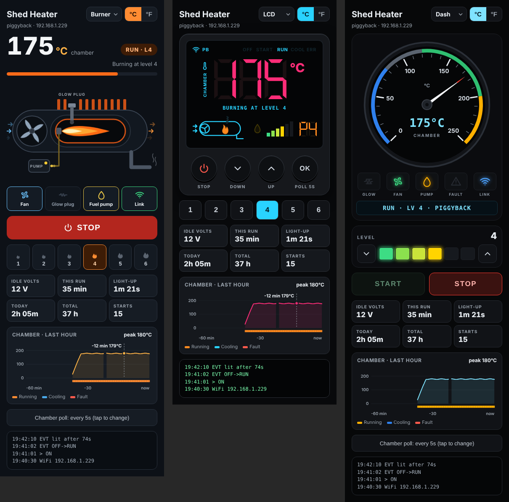
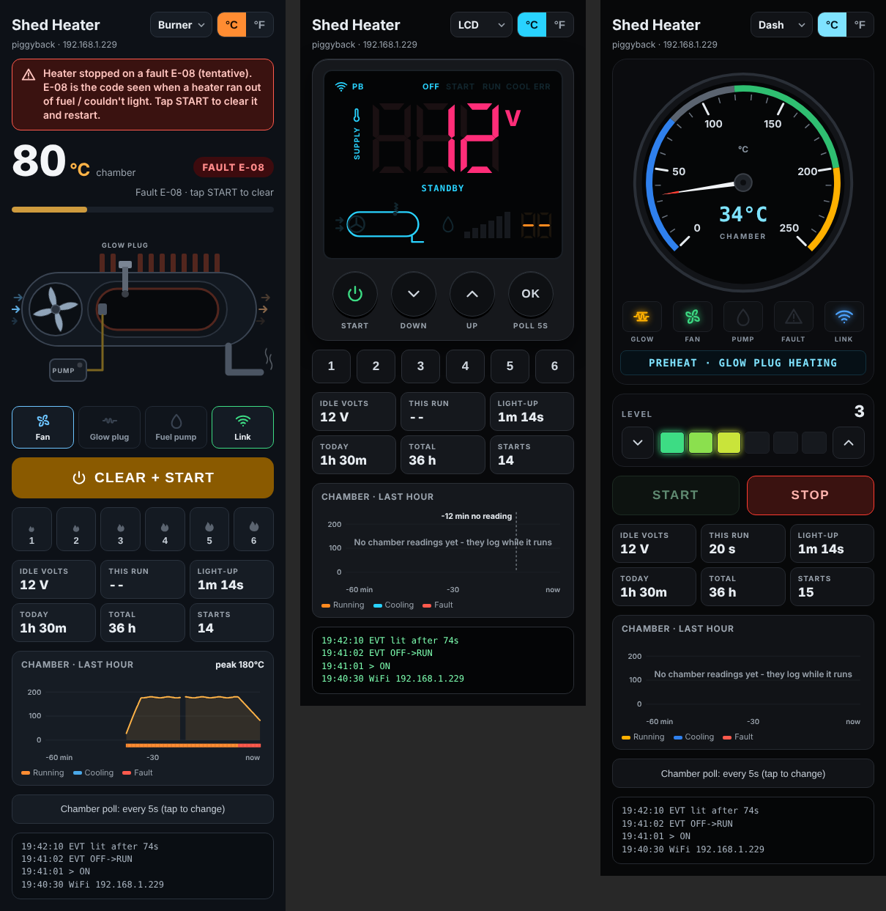
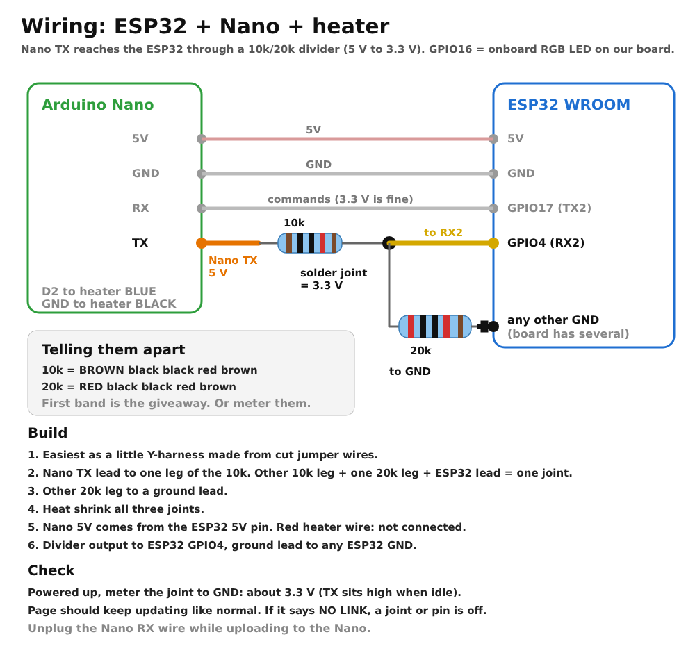
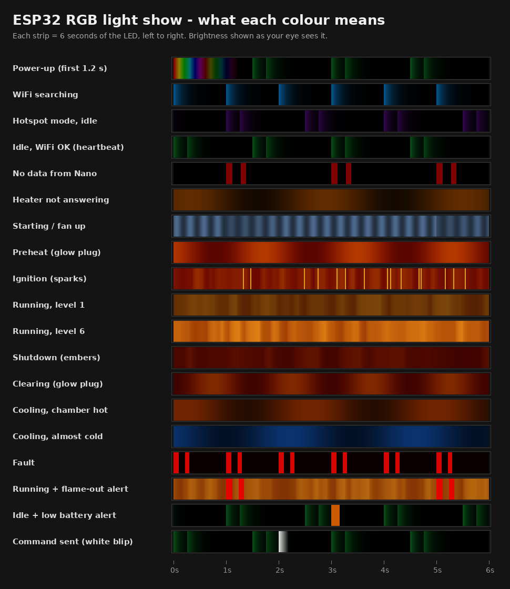

# Diesel heater blue-wire controller (ESP32 + Nano)

Phone control and live status for a cheap Chinese diesel air heater - the kind with the simple LCD controller on a red / blue / black cable. It talks the heater's own single-wire protocol, works **alongside the original display** (or without it), and serves a web page from an ESP32 that any phone on your WiFi can open.



## What it does

- **Start, stop, and set the level 1-6** from a phone. The original display stays plugged in and keeps working.
- **Live status decoded from the heater**: fan, glow plug, fuel pump, the actual phase it's in (fan up, preheat, ignition, running, shutdown, clearing, purge), the level, chamber temperature, and the supply voltage the OEM display shows.
- **Fault codes** (tentative E-number) and a START button that clears a fault, like the OEM display does.
- **Stats**: this run, how long it took to light, run time today, total hours, number of starts. Saved through power cuts.
- **Graph** of chamber temperature for the last hour.
- **Alerts**: fault, flame-out (glow plug coming back on mid-run, or the chamber dropping fast), slow ignition, not warming up, low / high battery.
- **Three page styles** you pick from a dropdown: a burner cutaway, an OEM-style 7-segment LCD, and a car-cluster gauge. °C / °F.
- **RGB LED light show** on boards that have one on GPIO16: heartbeat when idle, flickering flame that grows with the level, glow-plug throb, cooling glow, red fault flashes.
- **Over-the-air updates** for the ESP32, mDNS (`http://heater.local`), and a fallback WiFi hotspot.

Everything the pages need is built into the ESP32 - no internet, no app, no cloud.



## How it works

```
phone --WiFi--> ESP32 (web page, stats, alerts) --serial 115200--> Arduino Nano --blue wire--> heater
                                                                       ^
                                                     original LCD display stays on the same wire
```

The **Nano** does the timing-critical bus work at the heater's native 5 V: it listens to every frame, decodes the status, and slips one command frame into the quiet gap after the heater answers the display. The **ESP32** does WiFi, the pages, history and alerts, and talks to the Nano with plain text lines.

The protocol itself is written up in **[docs/PROTOCOL.md](docs/PROTOCOL.md)** - frame timing, commands, the status word, phases, supply voltage, chamber temperature calibration, fault codes, and the piggyback trick.

## Parts

- ESP32 dev board (WROOM). Ours has an RGB LED on GPIO16 - if yours doesn't, set `LED_MAX` to 0.
- Arduino Nano (ATmega328P, 5 V).
- One 10 kΩ and one 20 kΩ resistor (the Nano's 5 V TX into the ESP32's 3.3 V RX).
- Jumper wires. A 5 V supply for the ESP32: USB battery bank, USB car adapter, or a 12 V → 5 V converter.

## Wiring



| From | To |
|------|----|
| ESP32 **5V** | Nano **5V** pin (a Nano that's short on power sends garbled serial - check this first if the page shows junk) |
| ESP32 **GND** | Nano **GND** |
| ESP32 **GPIO17** (TX2) | Nano **RX** (D0) |
| Nano **TX** (D1) → **10 kΩ** → ESP32 **GPIO4** (RX2), with **20 kΩ** from GPIO4 to GND | about 3.3 V at the ESP32 pin |
| Nano **D2** | heater **blue** wire |
| Nano **GND** | heater **black** wire |
| heater **red** | not connected |

ESP32 pins are not 5 V tolerant, hence the divider on the Nano's TX. The ESP32's 3.3 V TX into the Nano's RX is fine as is.

## Setup

1. **Nano**: open `firmware/heater_bridge_nano`, board *Arduino Nano*, processor *ATmega328P (Old Bootloader)* for most clones. **Unplug the wire on the Nano's RX pin while uploading**, then put it back. Serial Monitor at 115200 should say `HEATER BRIDGE v1.2 ready`. You can type `STATUS`, `ON`, `OFF`, `UP`, `DOWN`, `LEVEL 4` there to test it on its own.
2. **ESP32**: open `firmware/heater_web_esp32`, put your WiFi name and password in `WIFI_SSID` / `WIFI_PASS`, board *ESP32 Dev Module* (ESP32 core 3.x, no extra libraries). Upload. The Serial Monitor (115200) prints the IP.
3. **Phone**: open that IP, or `http://heater.local`. If WiFi fails, the ESP32 makes its own hotspot `HeaterCtl` / `heater123` at `http://192.168.4.1`.

After the first upload, the ESP32 updates over WiFi: *Tools > Port > heater*. On Windows, set the WiFi network to Private and allow `espota.exe` through the firewall, or the upload sits at "No response from device".

## The chamber temperature

The heater reports a raw count, not degrees. `CAL[]` in the ESP32 sketch maps it to °C using readings taken off the OEM display's own chamber screen. If your heater's numbers differ, swap in your own pairs.

The OEM display only asks for chamber temperature while you're on its chamber screen, so the Nano asks for it itself every 5 s while the heater runs or cools (button on the page: 5 s / 30 s / off).

## API

The pages use a small JSON API you can use too:

| Endpoint | |
|----------|-|
| `GET /api/status` | everything: state, phase, level, flags, chamber °C, volts, fault code, stats, alert, log |
| `GET /api/history` | last hour of chamber °C, one point per 15 s, plus a state letter per point |
| `GET /api/cmd?c=on\|off\|up\|down` | send a command |
| `GET /api/cmd?c=level&n=1..6` | step to a level |
| `GET /api/cmd?c=chamber&n=0..60` | chamber poll interval in seconds (0 = off) |
| `GET /api/unit?u=C\|F`, `/api/theme?t=burner\|lcd\|dash` | saved settings |

## Light show



## Repo layout

```
firmware/heater_bridge_nano/   Nano bus bridge
firmware/heater_web_esp32/     ESP32 web controller (web_*.h are generated pages, led_show.h is the LED engine)
web_src/                       page sources - edit these, then run build_pages.py to regenerate web_*.h
tools/bus_sim/                 PC simulation of the bus (display + heater + bridge) to check timing changes
docs/                          protocol write-up and pictures
```

## Safety

This is a fuel-burning appliance. This project only sends the same button presses the original display sends - the heater's own controller still runs the burn, the safety shutdowns and the fault logic - but you are still remotely starting a combustion heater. Keep it installed properly with outside combustion air and exhaust, keep a CO alarm in the space, and don't run it unattended where that isn't safe. Use at your own risk.

## Still to do

- Room temperature sensor and a thermostat mode (ease the level down near the setpoint, minimum run time so the heater doesn't short-cycle).
- A single-board version: ESP32 straight on the blue wire through a BSS138 level shifter, no Nano.

## Credits

- [kellerman/vevor_pwm](https://github.com/kellerman/vevor_pwm) - an ESPHome take on the same pulse protocol; our bit values match theirs.
- [alxkalb/vevor-8kw-diesel-heater-esphome](https://github.com/alxkalb/vevor-8kw-diesel-heater-esphome) - their notes pointed us to the standby voltage, the phase flags and the fault words (they read the bits inverted).
- [zatakon/vevor_heater_control issue #7](https://github.com/zatakon/vevor_heater_control/issues/7) - the useful heads-up that the blue-LCD 3-wire controllers are not the 4800-baud UART kind.

Built by JR ([valleyprn-stack](https://github.com/valleyprn-stack)) with Claude. MIT license.
